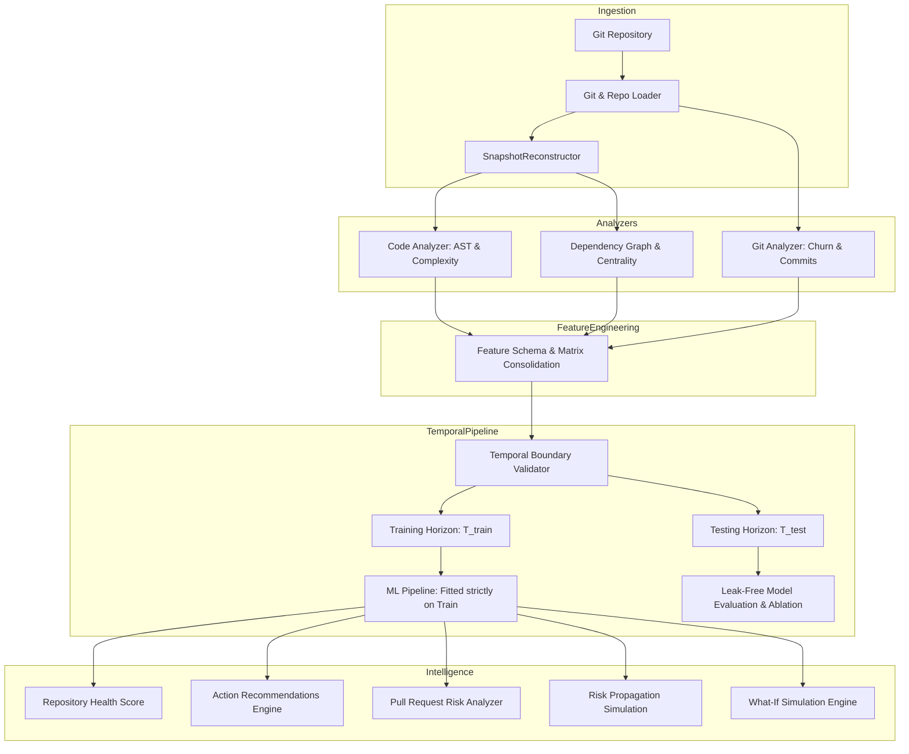

# SoftwarePulse: Evolution-Aware Software Risk Intelligence Platform

[](https://www.python.org/downloads/)
[](https://streamlit.io/)
[](https://scikit-learn.org/)
[]()
[](https://github.com/psf/black)

> **SoftwarePulse** is an evolution-aware software risk intelligence platform that analyzes a repository's source code characteristics, historical git churn, and dependency graph topology to estimate component-level risk, evaluate multidimensional repository health, generate actionable engineering recommendations, simulate risk propagation, and evaluate pre-merge pull request changes.

---

## 📌 Primary Research Question

> **"Does incorporating software evolution and dependency topology information improve component-level risk prediction compared with static source-code metrics alone?"**

SoftwarePulse demonstrates the quantitative transition from **static code analysis** to **evolution-aware predictive analytics**, empirically evaluating:
1. **Model A (Static Only)**: 6 features — LOC, Cyclomatic Complexity, Functions, Classes, Imports, Methods
2. **Model B (Static + Evolution)**: 13 features — Model A + Commit Count, Recent Commits, Churn, Recent Churn, Author Counts, Change Frequency, Time Since Last Change
3. **Model C (Static + Dependency)**: 12 features — Model A + Dependency Count, Dependent Count, Degree, Centrality, In-Degree, Out-Degree
4. **Model D (Full Model)**: 19 features — Complete combination of Static, Evolution, and Dependency features
5. **Zero-R Baseline**: Majority-class dummy classifier benchmark

---

## 🚀 Key Master Capabilities

- **Repository Health Score (Feature 1)**: Transparent 0–100 score and letter grade (A–F) evaluated across 5 distinct dimensions:
  - *Code Quality (25%)*, *Change Risk (25%)*, *Dependency Health (20%)*, *Stability (20%)*, and *Test Health (10%)*.
- **Intelligent Risk Recommendations (Feature 2)**: Rule-driven, evidence-backed action guidance categorized by severity (`CRITICAL`, `HIGH`, `MEDIUM`, `LOW`) addressing circular cycles, complexity hotspots, coupling hubs, and bus factor risks.
- **Interactive Dependency Graph & Risk Propagation (Feature 3)**:
  - 3-level directed neighborhood explorer (Hierarchical, Radial, Grouped).
  - Risk cascade propagation simulation: $Risk(v) = Risk_{origin} \cdot \delta^{depth}$.
  - Architecture diff visualization highlighting edge modifications and removals across evolutions.
- **Pull Request Risk Analyzer (Feature 4)**:
  - Pre-merge risk forecasting for local Git branch comparisons (`base..head`) and remote GitHub PR URLs.
  - Recalculates structural shifts and evaluates modified component representations through trained models.
  - Traces downstream dependents and suggests targeted verification test suites.
- **Feature Ablation Research Experiments (Feature 5)**:
  - Automated 4-way ablation framework evaluating incremental signal contributions.
  - Leakage-free temporal evaluation protocol with independent non-overlapping training and testing observation horizons.
- **Explainable AI**: Global feature importances and localized component risk factor attribution.
- **What-If Simulation Lab**: Interactive sandbox to simulate architectural refactorings and counterfactual modifications with instant predicted risk recalculation.
- **Professional Developer UI**: 15 dedicated dashboard pages built with Streamlit and Plotly with dark theme styling.

---

## 🛠️ System Architecture



---

## ⚡ Quickstart & Installation

### 1. Clone the Project
```bash
git clone https://github.com/HarshG045/Softpluse.git
cd Softpluse
```

### 2. Install Dependencies
```bash
pip install -r requirements.txt
```

### 3. Run the Application
```bash
streamlit run app.py
```
Open `http://localhost:8501` in your browser.

### 4. Run the Full Test Suite
```bash
pytest -v
# Output: 88 passed in ~55s
```

---

## 📂 Project Structure

```
SoftPluse/
├── app.py                      # Main Streamlit application entrypoint
├── config.py                   # Centralized configuration & parameters
├── requirements.txt            # Python dependencies
├── PROJECT_STATUS.md           # Implementation progress tracker
├── README.md                   # Project documentation
│
├── ingestion/                  # Git & repository loading
│   ├── repository_loader.py    # Local & remote GitHub cloning
│   ├── git_loader.py           # Commit extraction & churn mining
│   └── repository_metadata.py  # Repository summary dataclasses
│
├── analysis/                   # Code, Git, and Dependency parsing
│   ├── code_analyzer.py        # Python AST metrics & in-memory parsing
│   ├── git_analyzer.py         # File-level evolution metrics
│   ├── dependency_analyzer.py  # NetworkX dependency graph & AST graph builder
│   ├── historical_analyzer.py  # Chronological snapshot analyzer
│   ├── snapshot_reconstructor.py # Safe read-only Git tree snapshot reconstruction
│   └── change_analyzer.py      # Working tree & diff change impact analyzer
│
├── features/                   # Feature extraction & schema
│   ├── feature_schema.py       # Static, Evolution, and Structural schemas
│   └── feature_engineering.py  # Matrix consolidation & validation
│
├── dataset/                    # Temporal dataset construction
│   ├── labeling.py             # Bugfix association, provenance & proxy labeling
│   ├── temporal_split.py       # Chronological train-test splitting & leakage validation
│   └── builder.py              # End-to-end dataset builder with dual observation windows
│
├── health/                     # Feature 1: Repository Health Score
│   └── health_score.py         # 5-dimension scoring engine & grade classification
│
├── recommendations/            # Feature 2: Action Recommendations
│   └── recommendation_engine.py # Evidence-backed rule engine & priority guidance
│
├── pull_requests/              # Feature 4: Pull Request Risk Analyzer
│   ├── github_client.py        # Read-only GitHub API client
│   ├── pr_diff_parser.py       # Unified diff parser
│   └── pr_risk_analyzer.py     # Pre-merge risk predictor & downstream blast radius
│
├── experiments/                # Feature 5: Research Experiments
│   └── ablation.py             # 4-way feature ablation runner & reporting
│
├── ml/                         # Machine learning models & evaluation
│   ├── train.py                # Random Forest & Logistic Regression with train-only scaling
│   ├── predict.py              # Calibrated probability & component risk profiles
│   ├── evaluate.py             # Comparative research evaluation & Zero-R baseline
│   └── model_manager.py        # Model serialization & persistence
│
├── explainability/             # Explainable AI
│   └── explainer.py            # Global importance & local attribution
│
├── simulation/                 # Counterfactual change engine
│   └── what_if.py              # What-If structural & complexity simulation
│
├── visualization/              # Plotly chart generators
│   ├── risk_charts.py          # Distribution & top risky charts
│   ├── evolution_charts.py     # Historical metric trajectories
│   ├── dependency_graph.py     # Interactive network, risk propagation & architecture diff
│   └── component_view.py       # Radar & feature comparison plots
│
├── ui/                         # Streamlit design system
│   ├── styles.py               # Dark theme CSS & typography
│   ├── sidebar.py              # Hierarchical 15-page navigation
│   ├── header.py               # Top status bar
│   ├── components.py           # Metric blocks & badges
│   └── pages.py                # 15 dedicated dashboard pages
│
├── data/                       # Sample repositories
│   └── demo/                   # Built-in multi-commit microservices repo
│
├── tests/                      # Automated test suite (88 passed)
└── docs/                       # Technical & user documentation
    ├── architecture.md         # System architecture & temporal guarantees
    ├── methodology.md          # Research methodology & mathematical definitions
    ├── features.md             # Detailed feature catalogue
    ├── user_guide.md           # End-user walkthrough & workflows
    └── ENHANCEMENT_PLAN.md     # Audit & design plan
```

---

## 📄 Scientific Disclaimers

- **Risk Prediction**: Estimates statistical probability of future change volatility and defect association; does not prove the existence of bugs.
- **What-If Simulation**: Counterfactual sensitivity analysis modifying model feature representations; does not claim proven causal inference.
- **Test Health**: Measures test file presence and structural ratio; does not claim test execution coverage without dynamic test execution instrumentation.
```bash
cd SoftPluse
```

### 2. Install Dependencies
```bash
pip install -r requirements.txt
```

### 3. Run the Application
```bash
streamlit run app.py
```

The application will launch in your browser at `http://localhost:8501`.

### 4. Run Unit Tests
```bash
pytest -v
```

---

## 📂 Project Structure

```
SoftPluse/
├── app.py                      # Main Streamlit application entrypoint
├── config.py                   # Centralized configuration & parameters
├── requirements.txt            # Python dependencies
├── PROJECT_STATUS.md           # Mid-semester progress tracker
├── README.md                   # Project documentation
│
├── ingestion/                  # Git & repository loading
│   ├── repository_loader.py    # Local & remote GitHub cloning
│   ├── git_loader.py           # Commit extraction & churn mining
│   └── repository_metadata.py  # Repository summary dataclasses
│
├── analysis/                   # Code, Git, and Dependency parsing
│   ├── code_analyzer.py        # Python AST metrics & complexity
│   ├── git_analyzer.py         # File-level evolution metrics
│   ├── dependency_analyzer.py  # NetworkX dependency graph
│   └── historical_analyzer.py  # Chronological snapshot builder
│
├── features/                   # Feature extraction & schema
│   ├── feature_schema.py       # Static, Evolution, and Structural schemas
│   └── feature_engineering.py  # Matrix consolidation & validation
│
├── dataset/                    # Temporal dataset construction
│   ├── labeling.py             # Bugfix association & proxy labeling
│   ├── temporal_split.py       # Chronological train-test splitting
│   └── builder.py              # End-to-end dataset builder
│
├── ml/                         # Machine learning models & evaluation
│   ├── train.py                # Random Forest & Logistic Regression
│   ├── predict.py              # Calibrated probability & categories
│   ├── evaluate.py             # Comparative research evaluation
│   └── model_manager.py        # Model serialization & persistence
│
├── explainability/             # Explainable AI
│   └── explainer.py            # Global importance & local attribution
│
├── simulation/                 # Counterfactual change engine
│   └── what_if.py              # What-If structural & complexity simulation
│
├── visualization/              # Plotly chart generators
│   ├── risk_charts.py          # Distribution & top risky charts
│   ├── evolution_charts.py     # Historical metric trajectories
│   ├── dependency_graph.py     # Interactive network diagram
│   └── component_view.py       # Radar & feature comparison plots
│
├── ui/                         # Streamlit design system
│   ├── styles.py               # Dark theme CSS & typography
│   ├── sidebar.py              # Navigation & repo selector
│   ├── header.py               # Top status bar
│   ├── components.py           # Metric blocks & badges
│   └── pages.py                # Dashboard page implementations
│
├── data/                       # Storage & sample repositories
│   ├── demo/                   # Built-in multi-commit microservices repo
│   ├── raw/                    # Cached cloned repositories
│   └── processed/              # Datasets
│
├── models/                     # Saved trained models (.pkl)
├── tests/                      # Automated test suite (Pytest)
└── docs/                       # Technical & methodology documentation
    ├── architecture.md
    ├── methodology.md
    └── research_notes.md
```

---

## 🔬 Mid-Semester Presentation Workflow

1. **Launch App**: `streamlit run app.py`
2. **Overview**: View repository summary metrics and risk distribution.
3. **Risk Explorer**: Drill into prioritized components (e.g. `services/payment_service.py` with high complexity and recent churn).
4. **Explainability**: Identify contributing model signals (recent churn, complexity, dependency count).
5. **Evolution**: Track complexity and churn trajectory across commit snapshots.
6. **Dependencies**: Explore component neighborhood coupling.
7. **What-If Lab**: Simulate hypothetical modification (e.g. adding dependency or modifying complexity) and observe real-time predicted risk shift.
8. **Model Evaluation**: Review experimental comparison confirming that evolution + dependency features improve F1-Score over static code metrics alone.

---

## 📄 Scientific Disclaimers

- **Risk Prediction**: Estimates statistical probability of future change volatility and defect association; does not prove the existence of bugs.
- **What-If Simulation**: Counterfactual sensitivity analysis modifying model feature representations; does not claim proven causal inference.
"# Softpluse" 
