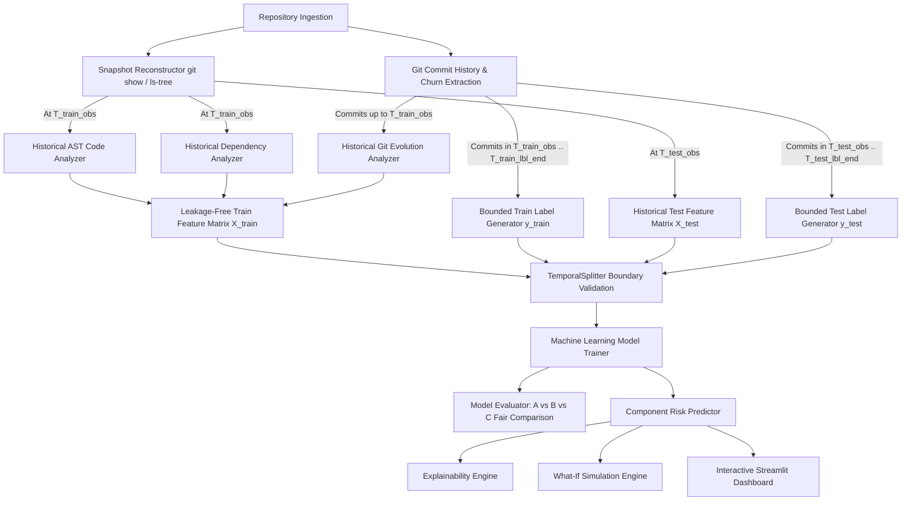

# SoftwarePulse Architecture

## 1. System Overview

SoftwarePulse is an evolution-aware AI platform for software risk prediction and counterfactual change simulation. It integrates static code characteristics, historical repository behavior, and graph dependency topology into a unified predictive pipeline with strict guarantees against temporal data leakage.

## 2. Core Subsystems

### 2.1 Ingestion Subsystem (`ingestion/`)
- `RepositoryLoader`: Validates local folders or clones remote GitHub repositories safely.
- `GitLoader`: Extracts commit records, timestamps, commit messages, insertions, deletions, author data, and bugfix heuristics.
- `RepositoryMetadata`: Tracks repository statistics (contributors, languages, branches, dates).

### 2.2 Analysis Subsystem (`analysis/`)
- `SnapshotReconstructor`: Extracts repository state at historical commits using read-only Git operations (`git ls-tree`, `git show`). Never modifies the working tree or checks out commits.
- `CodeAnalyzer`: Extracts Python AST-based cyclomatic complexity, lines of code, functions, classes, imports, and methods directly from files or in-memory source content (`analyze_source_content`).
- `GitAnalyzer`: Computes file-level evolution metrics, recent churn, historical churn, commit frequency, and author distribution restricted strictly to commits as of a given timestamp.
- `DependencyAnalyzer`: Parses module imports, resolves intra-repository dependencies, and constructs directed graphs via NetworkX from disk or metrics (`build_graph_from_metrics`).
- `HistoricalAnalyzer`: Reconstructs chronological repository snapshots along the commit history using `SnapshotReconstructor`.
- `SnapshotEngine`: Caches and diffs historical commit snapshots for architectural evolution exploration.

### 2.3 Feature Subsystem (`features/`)
- `feature_schema.py`: Formulates three distinct feature groups:
  1. **Static Features (6)**: LOC, Complexity, Functions, Classes, Imports, Methods
  2. **Evolution Features (7)**: Commit Count, Recent Commits, Churn, Recent Churn, Authors, Change Frequency, Time Since Last Change
  3. **Structural Features (6)**: Dependency Count, Dependent Count, Total Degree, Centrality, In-Degree, Out-Degree
- `feature_engineering.py`: Consolidates multi-modal metrics into standardized matrices with median imputation and missing value handling.

### 2.4 Dataset Subsystem (`dataset/`)
- `labeling.py`: Generates ground-truth future bugfix labels or explicit high-churn proxy labels within bounded $(T_{start}, T_{end}]$ time windows. Tracks commit provenance for all positive labels and never fabricates labels for single-class datasets.
- `temporal_split.py`: Strict chronological train-test split preventing future data leakage. Enforces boundary validation assertions (`validate_temporal_boundaries`) ensuring independent training and testing future label windows.
- `builder.py`: Orchestrates historical snapshot feature extraction at $T_{train\_obs}$ and $T_{test\_obs}$ via `SnapshotReconstructor`, computes bounded labels, and builds the leakage-free `BuiltDataset`.

### 2.5 Machine Learning Subsystem (`ml/`)
- `train.py`: Trains Random Forest and Logistic Regression classifiers. Preprocessing (`SimpleImputer`, `StandardScaler`) is encapsulated in Scikit-Learn Pipelines fitted strictly on training data. Single-class datasets are handled transparently with `DummyClassifier` baselines without label fabrication.
- `predict.py`: Infers calibrated risk probabilities and assigns LOW, MEDIUM, and HIGH categories.
- `evaluate.py`: Executes fair comparative evaluation across Model A (Static), Model B (Static+Evolution), and Model C (Full) using identical evaluation samples and labels. Calculates ROC-AUC only when mathematically valid, reports majority baselines, and tracks class distributions.
- `model_manager.py`: Model serialization and persistence.

### 2.6 Simulation & Explainability Subsystem (`simulation/`, `explainability/`)
- `what_if.py`: Counterfactual simulation engine for dependency additions/removals, complexity shifts, and churn adjustments. Recalculates graph structure and evaluates new risk predictions.
- `explainer.py`: Attribution signals and feature importance decomposition for component risk profiles.
